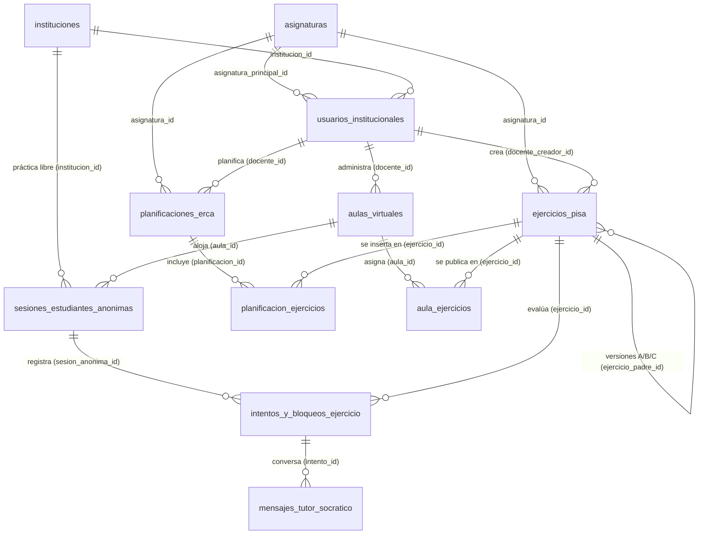

# Auditoría de Esquema Relacional (3FN, Estándar SQL ISO/IEC 9075 y Políticas RLS) — ECduLearn

- **Proyecto:** ECduLearn — Plataforma EdTech SaaS B2B (1ro a 3ro BGU · Ecuador)
- **Archivo Auditado:** [`supabase/schema.sql`](file:///c:/ECduLearn_Software/supabase/schema.sql) (v2.0.0, 1412 líneas) y su consumo en [`src/services/dbService.ts`](file:///c:/ECduLearn_Software/src/services/dbService.ts) (commit `f9f95f1`)
- **Marco Normativo:** Tercera Forma Normal (3FN) de E. F. Codd, Estándar SQL ISO/IEC 9075 y principio de mínimo privilegio (*Zero-Trust* / RLS en PostgreSQL).

---

## 1. Diagrama Entidad-Relación (ERD) del Esquema v2.0.0

---

## 2. Verificación de Tercera Forma Normal (3FN) y Restricciones de Dominio

| Tabla (`public.*`) | Clave Primaria (PK) | Claves Foráneas (FK) e Integridad | Restricciones de Dominio (`CHECK` / `UNIQUE`) | Cumplimiento 3FN y Sincronización con `dbService.ts` (`f9f95f1`) |
| :--- | :--- | :--- | :--- | :--- |
| [`asignaturas`](file:///c:/ECduLearn_Software/supabase/schema.sql#L56-L60) | `id SMALLINT` | — | `UNIQUE (nombre)` | ✅ **Cumple 3FN.** Catálogo normalizado de materias. |
| [`instituciones`](file:///c:/ECduLearn_Software/supabase/schema.sql#L62-L83) | `id UUID` | — | `ck_instituciones_amie`, `ck_instituciones_tipo`, `ck_instituciones_plan`, `ck_instituciones_pin` (`^[A-Z0-9]{6}$`), `ck_instituciones_limite` (`1..500`). | ✅ **Cumple 3FN.** Todos los atributos dependen exclusivamente de `id`. |
| [`usuarios_institucionales`](file:///c:/ECduLearn_Software/supabase/schema.sql#L85-L114) | `id UUID` | `institucion_id` → `instituciones(id)`, `asignatura_principal_id` → `asignaturas(id)`, `auth_user_id` → `auth.users(id)` | `UNIQUE (auth_user_id)`, `UNIQUE (email_institucional)`, `ck_usuarios_email`, `ck_usuarios_rol` (`DOCENTE`, `COORDINADOR_RECTOR`, `ADMIN`). | ✅ **Cumple 3FN.** Vinculación automática por trigger `trg_vincular_usuario_auth` cuando el correo está confirmado. |
| [`ejercicios_pisa`](file:///c:/ECduLearn_Software/supabase/schema.sql#L117-L168) | `id UUID` | `docente_creador_id` → `usuarios_institucionales(id)`, `ejercicio_padre_id` → `ejercicios_pisa(id)`, `asignatura_id` → `asignaturas(id)` | `ck_ejercicios_curso`, `ck_ejercicios_dificultad`, `ck_ejercicios_pistas_array`, `uq_ejercicio_version_hermana`. | ✅ **Cumple 3FN.** Sincronizado con `guardarComoActivo`, `actualizarEjercicio` y `etiquetaLibre`. |
| [`planificaciones_erca`](file:///c:/ECduLearn_Software/supabase/schema.sql#L170-L195) | `id UUID` | `docente_id` → `usuarios_institucionales(id)`, `asignatura_id` → `asignaturas(id)` | `ck_plan_curso`, `ck_plan_duracion` (`15..300`). | ✅ **Cumple 3FN.** Sincronizado en `planificacionesController`. |
| [`planificacion_ejercicios`](file:///c:/ECduLearn_Software/supabase/schema.sql#L198-L210) | `(planificacion_id, ejercicio_id)` | `planificacion_id` → `planificaciones_erca(id)`, `ejercicio_id` → `ejercicios_pisa(id)` | `ck_plan_ej_orden` (`orden >= 1`). | ✅ **Cumple 3FN.** Tabla puente N:M. |
| [`aulas_virtuales`](file:///c:/ECduLearn_Software/supabase/schema.sql#L212-L234) | `id UUID` | `docente_id` → `usuarios_institucionales(id)`, `planificacion_id` → `planificaciones_erca(id)` | `UNIQUE (pin_acceso)`, `ck_aulas_pin` (`^[A-Z0-9]{6}$`), `ck_aulas_modo` (`RETO_CLASE`, `SIMULADOR_ADMISION`), `ck_aulas_cupo` (`1..200`). | ✅ **Cumple 3FN.** Soporta tanto retos de clase como simuladores con tiempo límite. |
| [`aula_ejercicios`](file:///c:/ECduLearn_Software/supabase/schema.sql#L236-L242) | `(aula_id, ejercicio_id)` | `aula_id` → `aulas_virtuales(id)`, `ejercicio_id` → `ejercicios_pisa(id)` | `ck_aula_ej_orden` (`orden >= 1`). | ✅ **Cumple 3FN.** Sincronizado en `aulasController.publicarAula`. |
| [`sesiones_estudiantes_anonimas`](file:///c:/ECduLearn_Software/supabase/schema.sql#L244-L268) | `id UUID` | `aula_id` → `aulas_virtuales(id)`, `institucion_id` → `instituciones(id)` | `ck_sesiones_alias` (`^Estudiante #[0-9]{1,6}$`), `ck_sesiones_token` (`^[a-f0-9]{64}$`), `ck_sesiones_ambito`. | ✅ **Cumple 3FN y Zero-PII a nivel de motor.** El `CHECK` impide guardar nombres reales en `alias_temporal`. |
| [`intentos_y_bloqueos_ejercicio`](file:///c:/ECduLearn_Software/supabase/schema.sql#L271-L298) | `id BIGINT` | `sesion_anonima_id` → `sesiones_estudiantes_anonimas(id)`, `ejercicio_id` → `ejercicios_pisa(id)` | `UNIQUE (sesion_anonima_id, ejercicio_id)`, `ck_intentos_paso` (5 fases cerradas), `ck_intentos_opcion` (`0..5`). | ✅ **Cumple 3FN.** Las métricas dependen de la clave candidata `(sesion_anonima_id, ejercicio_id)`. |
| [`mensajes_tutor_socratico`](file:///c:/ECduLearn_Software/supabase/schema.sql#L300-L317) | `id BIGINT` | `intento_id` → `intentos_y_bloqueos_ejercicio(id)` | `ck_mensajes_remitente`, `ck_mensajes_tipo`, `ck_mensajes_largo` (`1..4000`). | ✅ **Cumple 3FN.** Vinculado directamente al intento (`intento_id`), eliminando redundancia de `(sesion_id, ejercicio_id)`. |

---

## 3. Auditoría de Políticas de Seguridad a Nivel de Fila (RLS) y Permisos

| Entidad / Recurso | Rol `anon` (Estudiante con PIN) | Rol `authenticated` (Docente) | Rol `authenticated` (Coordinador / Rector) | Rol `authenticated` (`ADMIN`) |
| :--- | :---: | :---: | :---: | :---: |
| Tablas físicas (`instituciones`, `usuarios_institucionales`, `ejercicios_pisa`, etc.) | 🚫 **Sin acceso directo** (`REVOKE ALL FROM anon`) | ✅ CRUD sobre sus propios recursos y `SELECT` de su `institucion_id` | ✅ `SELECT` sobre su `institucion_id` + `fn_dashboard_institucion()` | ✅ Gestión global de usuarios e instituciones (`pol_admin_gestionar_usuarios`) |
| Funciones RPC Estudiantiles (`fn_iniciar_sesion_anonima` .. `fn_finalizar_sesion`) | ✅ `EXECUTE` validado por `sesion_id` + `token_dispositivo_hash` (SHA-256) | ✅ `EXECUTE` | ✅ `EXECUTE` | ✅ `EXECUTE` |
| Vistas Analíticas (`vw_tiempo_ahorrado_docente`, `vw_completitud_socratica_aula`, `vw_pasos_bloqueo_aula`) | 🚫 Sin acceso (`REVOKE ALL FROM anon`) | ✅ `SELECT` filtrado por `security_invoker = true` | ✅ `SELECT` de su institución | ✅ `SELECT` global |

