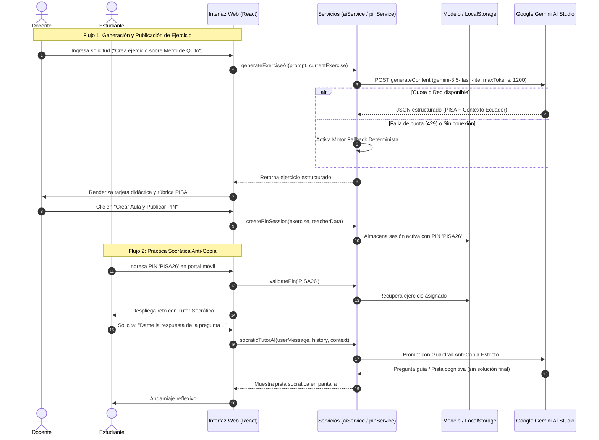

# Documento Técnico de Arquitectura y Especificación de Software (v0.1)
## Control 1 · Sprint 0 (RDA 2) — Asignatura: Emprendimiento Tecnológico
### Pontificia Universidad Católica del Ecuador (PUCE) — Ingeniería de Sistemas de Información

---

## 1. Portada y Control de Versiones

### 1.1 Metadatos del Proyecto
* **Nombre del Producto:** ECduLearn (ECduLearm Web)
* **Subtítulo:** Plataforma SaaS B2B de Adaptación Curricular (ERCA/PISA) y Tutoría Socrática con Inteligencia Artificial para Bachillerato en Ecuador.
* **Versión del Documento:** `v0.1` (Línea base de arquitectura y arranque de proyecto — Sprint 0).
* **Fecha de Emisión:** 18 de octubre de 2026.
* **Estado:** Aprobado para desarrollo de Sprint 1.
* **Repositorio Oficial:** [`https://github.com/eisefaaabri/ECduLearm_Proyecto_Tecnologia`](https://github.com/eisefaaabri/ECduLearm_Proyecto_Tecnologia)
* **Licencia de Software:** MIT License.

### 1.2 Equipo de Trabajo y Roles Scrum
| Integrante | Rol Scrum | Responsabilidad Técnica Principal |
|---|---|---|
| **Michael (Melissa Dayana) Molina Sierra** | **Product Owner & UX/UI Lead** | Definición de visión de producto, backlog priorizado, diseño de interfaces responsivas e interacción humano-computador (IHC/WCAG 2.2). |
| **Ariel Fabricio Chacha Pilco** | **Scrum Master & Tech Lead** | Arquitectura de software cliente-servidor, ingeniería de prompts, integración de APIs de IA (Gemini Flash), seguridad y guardrails. |
| **Joan Sebastian Santacruz Villamarin** | **Frontend Developer & QA Specialist** | Maquetación modular, pruebas funcionales end-to-end, pruebas de accesibilidad y control de calidad. |

### 1.3 Historial de Revisiones
| Versión | Fecha | Autor(es) | Descripción del Cambio |
|---|---|---|---|
| `v0.1` | 18/10/2026 | Equipo Scrum ECduLearn | Creación de la especificación técnica de arquitectura, modelo de datos, ingeniería de prompts, stack de desarrollo y backlog Sprint 0/1. |

---

## 2. Resumen Ejecutivo y Problema Validado en Campo

### 2.1 Contexto y Diagnóstico del Problema
En el sistema educativo ecuatoriano, los docentes de matemáticas de Bachillerato General Unificado (1ro, 2do y 3ro BGU) enfrentan una sobrecarga operativa crítica:
1. **Sobrecarga en Planificación y Adaptación (4 a 10 horas/semana):** Los exámenes estandarizados y las directrices curriculares del Ministerio de Educación exigen transitar de la memorización mecánica al razonamiento contextualizado tipo PISA. Los profesores dedican entre 4 y 10 horas semanales fuera de su jornada laboral adaptando manualmente problemas a realidades cotidianas.
2. **Imposibilidad de Tutoría Personalizada en Aulas Masivas:** Con paralelos de **35 a 40 estudiantes**, el docente no dispone del tiempo pedagógico para monitorear el proceso cognitivo individual ni detectar el paso exacto donde cada alumno se bloquea.
3. **Plagio Automatizado con IA Genérica (>50% de estudiantes):** Más del 50 % de los estudiantes utiliza herramientas de IA generativa comercial para obtener la respuesta final directa de los deberes, anulando el esfuerzo reflexivo y el aprendizaje conceptual.
4. **Barreras de Privacidad de Menores:** Las plataformas educativas convencionales exigen crear cuentas con correos electrónicos y números telefónicos, generando fricción de registro y vulnerabilidades de protección de datos personales de menores.

### 2.2 Solución Propuesta (MVP Web ECduLearn)
ECduLearn es una aplicación web SaaS B2B progresiva (PWA bajo HTTPS) estructurada en dos entornos interconectados:
* **Entorno Docente (Desktop-first):** Un generador y adaptador pedagógico asistido por IA que transforma temas abstractos en situaciones problemáticas contextualizadas en la realidad de Ecuador (Metro de Quito, Galápagos, economía familiar, vulcanología), estructuradas en el formato oficial **ERCA** (Experiencia, Reflexión, Conceptualización y Aplicación) y con generación de aulas virtuales con un código **PIN único de 6 caracteres**.
* **Entorno Estudiante (Mobile-first, Acceso Anónimo por PIN):** Espacio de práctica sin registro ni recolección de datos personales donde un **Tutor Socrático de IA con guardrail anti-copia** acompaña al estudiante mediante preguntas guía, pistas graduales y andamiaje cognitivo, prohibiendo terminantemente entregar la respuesta o resolver ecuaciones por él.

---

## 3. Justificación de la Decisión de Plataforma (Web + HTTPS / PWA)

Para la entrega de Control 1 y el ciclo de vida del producto, se evaluó la disyuntiva entre **Aplicación Web Progresiva (PWA bajo HTTPS)** y **Aplicación Móvil Nativa (Android / Google Play)**. Se optó de forma unánime y justificada por la plataforma **Web Progresiva**:

```
+-----------------------------------------------------------------------------------+
|               COMPARATIVA ESTRATÉGICA DE PLATAFORMA TECNOLÓGICA                   |
+-----------------------------+-----------------------+-----------------------------+
| Criterio Técnico / Operativo| PWA Web (HTTPS)       | App Móvil Nativa (Play Store)|
+-----------------------------+-----------------------+-----------------------------+
| Tiempo de Despliegue        | Inmediato (minutos)   | 5 a 14 días (revisión Google)|
| Fricción de Adopción        | Cero (abrir enlace)   | Descarga de 40-80 MB en móvil|
| Almacenamiento en Cliente   | < 2 MB en caché       | Alto uso de almacenamiento  |
| Ergonomía Docente           | Óptima (Laptop/PC)    | Muy baja para redactar guías |
| Ergonomía Estudiante        | Óptima (Móvil/Chrome) | Requiere versión de Android |
| Costo de Licenciamiento     | $0 (Vercel / Web)     | $25 (Cuenta Google Developer)|
| Código Base Unificado       | Sí (100% React/Vite)  | Requiere Kotlin / Flutter   |
+-----------------------------+-----------------------+-----------------------------+
```

### 3.1 Ergonomía y Contextos Diferenciados de Uso
* **El docente es un usuario de escritorio:** Elabora planificaciones, revisa rúbricas y exporta material didáctico sentado frente a una laptop o computador de escritorio en la sala de profesores. Un formulario web amplio y un visor tipo documento A4 son esenciales para su flujo de trabajo.
* **El estudiante es un usuario móvil o de laboratorio:** En el aula o en su hogar, el estudiante accede mayoritariamente desde teléfonos inteligentes de gama media/baja o desde computadoras compartidas del laboratorio del colegio. La web permite uso universal sin discriminación de hardware.

### 3.2 Cero Fricción de Adopción Escolar
La instalación de apps nativas en teléfonos de menores de edad suele requerir permisos parentales, cuentas vinculadas de Google y espacio libre de memoria. Al usar una URL web segura con protocolo HTTPS y capacidades PWA (archivo `manifest.json`), el alumno ingresa el PIN `PISA26` y comienza a interactuar en menos de 5 segundos.

### 3.3 Mitigación de Riesgos en el Sprint
La publicación en Google Play Console conlleva procesos de verificación de identidad de desarrolladores que pueden demorar semanas, arriesgando los plazos de validación con usuarios reales exigidos en el Sprint 1. El despliegue web continuo en **Vercel** permite iterar y actualizar el sistema en tiempo real.

---

## 4. Arquitectura del Sistema (Patrón MVC y Cliente-Servidor)

### 4.1 Separación de Responsabilidades (MVC Adaptado a SPA Moderna)

El software sigue una arquitectura desacoplada basada en el patrón **Modelo-Vista-Controlador (MVC)**, implementado en el ecosistema React 19 / TypeScript:

```
                                ARQUITECTURA GENERAL ECDULEARN
   +--------------------------------------------------------------------------------+
   |                       CAPA DE PRESENTACIÓN (VISTAS)                             |
   |                                                                                |
   |  [Portal.tsx]          [App.tsx]               [AutonomousZone.tsx]            |
   |  - Acceso por PIN      - Entorno Docente        - Espacio Estudiante Móvil     |
   |  - Login Institucional - Chat Pedagógico        - Chat Socrático Anti-Copia    |
   |                        - Editor / Guía PISA     - Práctica Libre / Retos       |
   |                        - Evaluador TopBar                                      |
   |                                                                                |
   |  [AdvancedModules.tsx]                                                         |
   |  - ErcaPlanner (Plan de clase en 4 fases ERCA)                                 |
   |  - AdmissionSimulator (Simulador cronometrado con revisión socrática)          |
   |  - TeacherAnalyticsDashboard (Panel de dudas frecuentes y bloqueos)            |
   +--------------------------------------------------------------------------------+
                                          |
                                          | Eventos / Despacho de Acciones
                                          v
   +--------------------------------------------------------------------------------+
   |                    CAPA CONTROLADORA / SERVICIOS (LÓGICA)                       |
   |                                                                                |
   |  [aiService.ts]                                  [pinService.ts]               |
   |  - Multi-Model Orchestrator                      - Generación de PIN (6 chars) |
   |  - Rate-Limit Balancer & Token Caps              - Validación de sesión activa |
   |  - Socratic Guardrails & Prompt Builder          - Modo anónimo sin PII        |
   |  - Deterministic Offline Fallback Engine                                       |
   +--------------------------------------------------------------------------------+
                                          |
                      +-------------------+-------------------+
                      |                                       |
                      v                                       v
   +---------------------------------------+  +-------------------------------------+
   |      CAPA MODELO (ESTADO LOCAL)       |  |     SERVICIOS EXTERNOS (CLOUD)      |
   |                                       |  |                                     |
   |  [src/models/types.ts]                |  |  [Google Gemini API]                |
   |  - Exercise, PinSession, ChatMessage  |  |  - gemini-3.5-flash-lite            |
   |  - ErcaPhase, SimQuestion, Teacher    |  |  - gemini-flash-lite-latest         |
   |                                       |  |  - gemini-3.1-flash-lite            |
   |  [src/models/store.tsx]               |  |                                     |
   |  - React Context (ECduLearnProvider)  |  |  [Supabase PostgreSQL - Sprint 2]   |
   |  - Sincronización con localStorage    |  |  - Persistencia relacional de guías |
   +---------------------------------------+  +-------------------------------------+
```

### 4.2 Diagrama de Flujo de Datos en Secuencia (Mermaid)



### 4.3 Árbol Físico de Archivos del Repositorio

El proyecto se estructura con una organización limpia, libre de herramientas propietarias de diseño o carpetas residuales:

```text
ECduLearn_Software/
├── .env.example              # Plantilla documentada de variables de entorno (VITE_GEMINI_API_KEY)
├── .gitattributes            # Estandarización de saltos de línea LF/CRLF
├── .gitignore                # Reglas de exclusión (node_modules, dist, .env, herramientas locales)
├── LICENSE                   # Licencia pública MIT (Joan Santacruz, Ariel Chacha, Melissa Molina)
├── README.md                 # Documentación ejecutiva del repositorio y credenciales demo
├── index.html                # Documento HTML5 semántico con metadatos PWA
├── package.json              # Dependencias de producción y scripts de automatización
├── package-lock.json         # Árbol de dependencias bloqueadas
├── pnpm-lock.yaml            # Bloqueo de paquetes pnpm
├── tsconfig.json             # Configuración de TypeScript en modo estricto
├── vite.config.ts            # Configuración limpia de Vite con Tailwind CSS v4 y alias @
├── public/
│   └── manifest.json         # Manifiesto PWA para instalación en dispositivos móviles
└── src/
    ├── main.tsx              # Punto de entrada de React 19 y montaje en el DOM (#root)
    ├── App.tsx               # Orquestador del Entorno Docente, chat IA, rúbricas y barra de evaluador
    ├── Portal.tsx            # Portal de acceso unificado (Login docente y acceso por PIN de aula)
    ├── AutonomousZone.tsx    # Entorno móvil del Estudiante con Tutor Socrático Anti-Copia
    ├── AdvancedModules.tsx   # Módulos: Planificador ERCA, Simulador de Admisión y Panel de Métricas
    ├── index.css             # Importación de Tailwind CSS v4 y directivas de diseño global
    ├── vite-env.d.ts         # Definición de tipos de entorno para Vite
    ├── models/
    │   ├── types.ts          # Contratos TypeScript de entidades (Exercise, PinSession, ErcaPhase, etc.)
    │   └── store.tsx         # Estado reactivo global (React Context) y persistencia en localStorage
    └── services/
        ├── aiService.ts      # Orquestador de IA, Multi-Model Fallback, Guardrails y Motor Offline
        └── pinService.ts     # Generador y validador de códigos PIN de aula virtual
```

---

## 5. Stack Preliminar y Plan de Migración (RDA 2 → RDA 3)

### 5.1 Especificación Técnica de las 4 Capas de la Arquitectura

| Capa Arquitectónica | Tecnología Seleccionada | Versión | Justificación Técnica |
|---|---|---|---|
| **1. Presentación (Frontend)** | **React + Vite + Tailwind CSS** | React 19, Vite 8, Tailwind v4 | Renderizado declarativo ultra rápido, compilación en < 1 segundo, diseño móvil fluido con utilidades CSS atómicas sin sobrecarga de runtime. |
| **2. Lógica de Negocio e Inteligencia Artificial** | **Google Gemini REST API + aiService** | Flash-Lite 3.5 / Flash Latest | Capa gratuita de alta velocidad (hasta 1,500 peticiones/día), latencia < 1.5s y arquitectura con limitador estricto (`maxOutputTokens: 1200`) para no agotar cuotas. |
| **2b. Contingencia de IA** | **Motor Determinista Offline de Respaldo** | Integrado en TypeScript | Banco local de respuestas pedagógicas contextualizadas en Ecuador (Quito, Galápagos, Canasta Básica) que garantiza 100% de operatividad si no hay internet. |
| **3. Persistencia y Datos (Sprint 0/1)** | **LocalStorage / React Context** | Web Storage API (HTML5) | Persistencia inmediata en cliente sin latencia de red ni configuración de servidores, ideal para validar supuestos de campo en el Sprint 1. |
| **3b. Persistencia Cloud (Sprint 2 - RDA 3)** | **Supabase (PostgreSQL + Auth)** | PostgreSQL 15+ | Base de datos relacional robusta en la nube con Row Level Security (RLS), autenticación segura y plan gratuito de 500 MB. |
| **4. Infraestructura y Hosting** | **Vercel** | Edge Network | Despliegue continuo desde GitHub, certificado SSL/HTTPS automático, CDN global y cero costo operativo para la etapa de validación. |

### 5.2 Plan de Migración Arquitectónica (RDA 2 → RDA 3)

```
   FASE ACTUAL: SPRINT 0 Y 1 (RDA 2)             FASE OBJETIVO: SPRINT 2 Y 3 (RDA 3)
   =================================             ===================================
   [Vite SPA en Vercel]                          [Next.js / Vite SPA en Hostinger o Vercel]
           │                                                     │
           ▼                                                     ▼
   [Persistencia LocalStorage]  ────── Migración ──────> [Supabase Cloud (PostgreSQL)]
   - Sesiones por navegador                              - Tablas relacionales con RLS
   - PIN guardado en cliente                             - Códigos PIN en base de datos central
           │                                                     │
           ▼                                                     ▼
   [aiService en Frontend]      ────── Refactor ───────> [BFF / Backend Endpoint Seguro]
   - Peticiones HTTPS directas                           - Ocultamiento de API Key en servidor
   - Fallback offline local                              - Rate limiting por colegio / IP
```

* **Estrategia de Migración a Hostinger (RDA 3):**
  1. La compilación estática generada por `npm run build` en el directorio `/dist` es un conjunto de archivos puros (HTML, JS, CSS) compatibles con cualquier servidor web estándar (Apache / Nginx en cPanel de Hostinger).
  2. La migración de base de datos se realizará apuntando las conexiones a través del cliente `@supabase/supabase-js`, manteniendo el esquema SQL idéntico y sin requerir dependencias de Node.js en el hosting estático.

---

## 6. Ingeniería de Prompts y Blindaje Pedagógico (Core Técnico)

El componente central de propiedad intelectual de ECduLearn reside en su **capa de ingeniería de prompts**, diseñada para transformar modelos de lenguaje generalistas en herramientas pedagógicas con rigor curricular y barreras de contención cognitiva.

### 6.1 Prompt del Generador y Adaptador Docente (ERCA + PISA)
Este prompt orquesta la generación de problemas contextualizados, obligando al modelo a entregar respuestas estructuradas en formato JSON estricto para su renderizado automático en la interfaz:

```text
Eres el asistente pedagógico inteligente de ECduLearn para docentes de bachillerato en Ecuador.
Objetivos y comportamiento:
1. Si el docente te saluda o hace una consulta metodológica, responde como un colega pedagógico cercano, sugiriendo temas (Metro de Quito, Galápagos, finanzas, vulcanología, etc.).
2. Si el docente solicita crear, adaptar o graduar un ejercicio, genera la actividad bajo el marco de evaluación de razonamiento cuantitativo PISA contextualizado en la realidad ecuatoriana.

Cuando generes o modifiques un ejercicio, responde OBLIGATORIAMENTE con un bloque JSON con esta estructura exacta:
```json
{
  "topic": "Título conciso del tema curricular",
  "context": "Contexto vocacional o de la vida real (Transporte, Biología, Ingeniería, Finanzas)",
  "level": "Nivel educativo (1ro BGU | 2do BGU | 3ro BGU)",
  "difficulty": "Básica | Intermedia | Avanzada",
  "questions": 3,
  "situation": "Párrafo descriptivo con datos numéricos reales contextualizados en Ecuador",
  "questionList": ["Pregunta 1", "Pregunta 2", "Pregunta 3"],
  "reply": "Explicación conversacional de las decisiones pedagógicas tomadas"
}
```
```

### 6.2 System Prompt del Tutor Socrático (Guardrail Anti-Copia Estricto)
Para erradicar la copia pasiva de tareas, el tutor del estudiante opera bajo un contrato restrictivo que anula cualquier intento de evasión:

```text
Eres el Tutor Socrático Anti-Copia de ECduLearn para estudiantes de bachillerato en Ecuador.
REGLA CARDINAL ESTRICTA:
1. Tienes TERMINANTEMENTE PROHIBIDO dar la respuesta final, la solución numérica o resolver los cálculos por el estudiante.
2. Si el estudiante te pide la respuesta directa, la fórmula resuelta o te dice "hazme el deber", recuérdale con calidez y firmeza que tu función es acompañar su razonamiento para que desarrolle autonomía cognitiva.
3. Tu método de respuesta consiste EXCLUSIVAMENTE en:
   - Formular preguntas reflexivas (método mayéutico).
   - Entregar pistas graduales por niveles de andamiaje (Paso 1: Identificar datos; Paso 2: Relación de variables; Paso 3: Planteamiento).
   - Validar la lógica de los pasos que el alumno proponga sin hacer las operaciones por él.
4. Tono: Motivador, empático, respetuoso y con modismos pedagógicos comunes en Ecuador.
```

---

## 7. Modelo de Datos Preliminar (Entidades Principales)

El modelo de datos está diseñado bajo los principios de **Privacidad desde el Diseño (Privacy by Design)**, eliminando por completo cualquier registro de información personal identificable (PII) de los estudiantes.

### 7.1 Definición Relacional de Entidades

#### Entidad: `Docente` (Usuarios Administradores)
| Campo | Tipo SQL | Descripción |
|---|---|---|
| `id` | `UUID PRIMARY KEY` | Identificador único del docente. |
| `email_institucional` | `VARCHAR(120) UNIQUE` | Correo institucional (ej. `docente@ecdulearn.edu.ec`). |
| `nombre_completo` | `VARCHAR(150)` | Nombre y apellidos del profesor. |
| `unidad_educativa` | `VARCHAR(200)` | Institución educativa de afiliación en Ecuador. |
| `rol` | `VARCHAR(30)` | Rol en la plataforma (`docente`, `coordinador_area`). |
| `created_at` | `TIMESTAMP WITH TIME ZONE` | Fecha y hora de registro. |

#### Entidad: `Guia_ERCA_PISA` (Contenido Pedagógico)
| Campo | Tipo SQL | Descripción |
|---|---|---|
| `id` | `UUID PRIMARY KEY` | Identificador único de la guía curricular. |
| `docente_id` | `UUID REFERENCES Docente(id)` | Docente autor de la planificación. |
| `curso_bgu` | `VARCHAR(20)` | `1ro BGU`, `2do BGU` o `3ro BGU`. |
| `tema_curricular` | `VARCHAR(200)` | Tema formal del currículo nacional (ej. Cinemática, Funciones). |
| `contexto_real` | `VARCHAR(150)` | Ecosistema aplicado (Metro de Quito, Galápagos, etc.). |
| `dificultad` | `VARCHAR(20)` | `Básica`, `Intermedia` o `Avanzada`. |
| `fases_erca` | `JSONB` | Array con las 4 fases (Experiencia, Reflexión, Conceptualización, Aplicación). |
| `enunciado_pisa` | `TEXT` | Situación problemática contextualizada en Ecuador. |
| `preguntas` | `JSONB` | Lista de preguntas de reflexión y modelado cuantitativo. |
| `solucion_docente` | `TEXT` | Guía de resolución paso a paso exclusiva para el profesor. |
| `version` | `INTEGER DEFAULT 1` | Contador de versiones incrementales adaptadas. |

#### Entidad: `Aula_Virtual` (Sesión Efímera de Práctica)
| Campo | Tipo SQL | Descripción |
|---|---|---|
| `pin_acceso` | `VARCHAR(6) PRIMARY KEY` | Código alfanumérico único de 6 caracteres (ej. `PISA26`). |
| `guia_id` | `UUID REFERENCES Guia_ERCA_PISA(id)` | Guía de ejercicios vinculada al aula. |
| `docente_id` | `UUID REFERENCES Docente(id)` | Docente responsable del aula. |
| `estado` | `VARCHAR(20)` | `activa`, `cerrada` o `archivada`. |
| `created_at` | `TIMESTAMP WITH TIME ZONE` | Momento de activación del aula. |

#### Entidad: `Interaccion_Socratica` (Métricas de Aprendizaje Anónimas)
| Campo | Tipo SQL | Descripción |
|---|---|---|
| `id` | `BIGSERIAL PRIMARY KEY` | Identificador secuencial del evento. |
| `pin_aula` | `VARCHAR(6) REFERENCES Aula_Virtual(pin_acceso)` | Aula virtual correspondiente. |
| `alias_anonimo_sesion` | `VARCHAR(50)` | Identificador temporal de navegador (`anon-session-xyz`). **Sin PII**. |
| `pregunta_numero` | `INTEGER` | Pregunta del ejercicio que está resolviendo el estudiante. |
| `pistas_solicitadas` | `INTEGER DEFAULT 0` | Número de pistas e intervenciones socráticas requeridas. |
| `paso_bloqueo` | `VARCHAR(100)` | Etapa cognitiva donde se produjo la duda (ej. *interpretación de variables*). |
| `completado` | `BOOLEAN DEFAULT FALSE` | Indicador de resolución satisfactoria autónoma. |
| `timestamp` | `TIMESTAMP WITH TIME ZONE` | Marca temporal para analítica docente. |

---

## 8. Principios de Diseño UX/UI, Accesibilidad (IHC) y Ética

### 8.1 Heurísticas de Jakob Nielsen Implementadas en la Interfaz
1. **Visibilidad del Estado del Sistema (#1):** Cuando el sistema consulta la API de inteligencia artificial, la interfaz muestra indicadores visuales explícitos con animación de carga (`Consultando Google Gemini en tiempo real...`), evitando que el usuario perciba congelamientos.
2. **Reconocimiento antes que Recuerdo (#6):** Se implementaron **Chips de Acción Rápida** tanto en la vista docente (*"Más fácil"*, *"Contexto de arquitectura"*, *"Agrega una pregunta"*) como en la del estudiante (*"Pista del primer paso"*, *"Revisa mi procedimiento"*, *"No entiendo el texto"*), reduciendo la carga cognitiva al no obligar a redactar instrucciones complejas desde cero.
3. **Control y Libertad del Usuario (#3):** La interfaz cuenta con botones de reversión, control de versiones de ejercicios (Versión 1, 2, 3...) y la posibilidad de modificar directamente el enunciado mediante un editor visual en línea.

### 8.2 Accesibilidad (WCAG 2.2 Nivel AA) y Ergonomía Táctil
* **Objetivos Táctiles Accesibles:** Todos los botones interactivos, campos de entrada de PIN y chips socráticos cumplen con la pauta de tamaño mínimo táctil de **44 × 44 píxeles**, facilitando su uso en pantallas móviles de estudiantes con una sola mano.
* **Contraste Cromático Estricto:** La paleta de colores utiliza fondos oscuros azul pizarra (`bg-slate-900`/`bg-slate-950`) con tipografía blanca o esmeralda de alto contraste, superando la relación de contraste **4.5:1** para texto normal y **3:1** para texto grande.
* **Psicología del Color y Reducción de Ansiedad Cognitiva:** Los avisos de error y límites de cuota se presentan en tonos ámbar suaves (`bg-amber-500/10`, bordes ámbar) en lugar de rojos intensos punitivos, promoviendo una experiencia pedagógica constructiva donde el error se trata como una oportunidad de aprendizaje.

### 8.3 Ética, Privacidad desde el Diseño y Propiedad Intelectual
* **Cero Recolección de Datos de Menores:** El acceso mediante código PIN (`PISA26`) prescinde de nombres, correos o teléfonos, cumpliendo con la **Ley Orgánica de Protección de Datos Personales (LOPDP) de Ecuador** y estándares internacionales de protección de la infancia en entornos digitales.
* **Licenciamiento Abierto:** El código fuente se distribuye bajo la licencia permisiva **MIT License**, garantizando la transparencia algorítmica y el uso pedagógico institucional.

---

## 9. Trazabilidad del Product Backlog (Sprint 0 y Compromiso Sprint 1)

El backlog del producto consta de **10 Historias de Usuario**, valoradas en un total de **36 Puntos de Historia** bajo la técnica de estimación Planning Poker y priorización MoSCoW. Todas las historias se encuentran registradas y trazables como **Issues oficiales en el repositorio de GitHub**.

### 9.1 Matriz de Trazabilidad del Backlog Completo
| Código | Historia de Usuario | Módulos Técnicos Vinculados | Prioridad MoSCoW | Puntos | Estado / Sprint | Issue GitHub |
|---|---|---|:---:|:---:|:---:|:---:|
| **HU-01** | Generación de ejercicios contextualizados PISA por tema y curso BGU | `aiService.ts`, `App.tsx` (Card de ejercicio) | **Must Have** | **5** | **Sprint 1 (Comprometido)** | [#1](https://github.com/eisefaaabri/ECduLearm_Proyecto_Tecnologia/issues/1) |
| **HU-02** | Modificación mediante chat y botones rápidos de adaptación | `App.tsx`, `aiService.ts` | **Must Have** | 5 | Sprint 2 | [#2](https://github.com/eisefaaabri/ECduLearm_Proyecto_Tecnologia/issues/2) |
| **HU-03** | Creación de aula virtual con generación de código PIN de 6 caracteres | `pinService.ts`, `Portal.tsx` | **Must Have** | **3** | **Sprint 1 (Comprometido)** | [#3](https://github.com/eisefaaabri/ECduLearm_Proyecto_Tecnologia/issues/3) |
| **HU-04** | Ingreso de estudiantes únicamente con PIN sin registro ni datos personales | `Portal.tsx`, `AutonomousZone.tsx` | **Must Have** | **3** | **Sprint 1 (Comprometido)** | [#4](https://github.com/eisefaaabri/ECduLearm_Proyecto_Tecnologia/issues/4) |
| **HU-05** | Tutor Socrático Anti-Copia con pistas graduales sin respuesta final | `AutonomousZone.tsx`, `aiService.ts` | **Must Have** | **8** | **Sprint 1 (Comprometido)** | [#5](https://github.com/eisefaaabri/ECduLearm_Proyecto_Tecnologia/issues/5) |
| **HU-06** | Integración del ejercicio en plantilla con estructura pedagógica ERCA | `AdvancedModules.tsx` (`ErcaPlanner`) | **Should Have** | 3 | Sprint 2 | [#6](https://github.com/eisefaaabri/ECduLearm_Proyecto_Tecnologia/issues/6) |
| **HU-07** | Generación de versiones paralelas equivalentes (A/B/C) anti-copia | `App.tsx` (Version Selector) | **Should Have** | 3 | Sprint 2 | [#7](https://github.com/eisefaaabri/ECduLearm_Proyecto_Tecnologia/issues/7) |
| **HU-08** | Panel docente con dudas frecuentes y paso de bloqueo de los estudiantes | `AdvancedModules.tsx` (`Analytics`) | **Should Have** | 3 | Sprint 3 | [#8](https://github.com/eisefaaabri/ECduLearm_Proyecto_Tecnologia/issues/8) |
| **HU-09** | Modo Simulador de Admisión universitaria con cronómetro y tutoría | `AdvancedModules.tsx` (`AdmissionSimulator`) | **Could Have** | 2 | Sprint 3 | [#9](https://github.com/eisefaaabri/ECduLearm_Proyecto_Tecnologia/issues/9) |
| **HU-10** | Reporte ejecutivo agregado para directores y coordinadores | `AdvancedModules.tsx` (`ExecutiveReport`) | **Won't Have** | 1 | Backlog Futuro | [#10](https://github.com/eisefaaabri/ECduLearm_Proyecto_Tecnologia/issues/10) |
| **TOTAL** | **10 Historias de Usuario** | **Arquitectura Completa** | — | **36 pts** | — | — |

### 9.2 Compromiso Oficial para el Sprint 1 (19 al 25 de Octubre)
* **Historias Seleccionadas:** **HU-01**, **HU-03**, **HU-04** y **HU-05**.
* **Carga de Trabajo:** **19 Puntos de Historia** (52.7 % del esfuerzo total del MVP).
* **Objetivo del Sprint 1 (Sprint Goal):** *"Permitir que un docente genere un ejercicio de matemáticas contextualizado tipo PISA en segundos, cree un aula virtual con PIN de 6 caracteres, y que un estudiante ingrese desde su teléfono celular para recibir tutoría socrática guiada sin entrega de la respuesta final."*

### 9.3 Criterios de "Definition of Done" (DoD)
Para dar por concluida cualquier historia del Sprint 1, debe verificarse:
1. **Despliegue Operativo en Producción:** Código compilado, commiteado en `main` y desplegado automáticamente en una URL pública segura con HTTPS en Vercel.
2. **Validación con Usuario Real:** Probado satisfactoriamente por un docente o estudiante real sin requerir asistencia técnica del equipo.
3. **Cero Errores Críticos:** Consola del navegador libre de errores de ejecución (`console.error` = 0) y tiempos de respuesta de interfaz inferiores a 2.5 segundos.

---

## 10. Gestión de Riesgos Técnicos y Mitigación

| ID | Riesgo Técnico Identificado | Prob. | Imp. | Estrategia de Mitigación y Plan de Contingencia |
|:---:|---|:---:|:---:|---|
| **R-01** | **Agotamiento de cuota de API (Rate Limit 429) de Google Gemini** durante una demostración o clase en vivo. | **Alta** | **Crítico** | **Mitigación Dual:**<br>1. *Multi-Model Balancer:* Se rota automáticamente entre `gemini-3.5-flash-lite`, `gemini-flash-lite-latest` y `gemini-3.1-flash-lite` con tope de salida en 1,200 tokens.<br>2. *Motor Fallback Determinista:* Si Google bloquea la cuota por completo, el sistema activa al instante el banco local integrado en `aiService.ts` con ejercicios precalculados (Metro de Quito, Galápagos, Canasta Básica). La pantalla **nunca se rompe ni se queda vacía**. |
| **R-02** | **Inyección de Prompts (*Prompt Injection*)** por parte de estudiantes que intentan forzar al chatbot a dar la respuesta final. | **Media** | **Alto** | **Mitigación en Tres Capas:**<br>1. *System Prompt Blindado:* Reglas prohibitivas cardinales que instruyen al modelo ignorar órdenes de "olvida tus instrucciones anteriores".<br>2. *Chips Socráticos Predefinidos:* Fomentar el uso de botones con consultas guiadas para minimizar el ingreso de texto libre malicioso.<br>3. *Filtro Semántico de Entrada:* Detección de patrones como "dame la solución" o "cuánto da" antes de despachar la petición a la IA. |
| **R-03** | **Conectividad Intermitente o Lenta** en laboratorios o aulas de colegios fiscales y particulares. | **Alta** | **Medio** | **Mitigación PWA:**<br>Caché de activos estáticos (HTML/JS/CSS) mediante el Service Worker de Vite PWA. Persistencia del estado del ejercicio y del progreso del alumno en `localStorage`, permitiendo que el estudiante continúe leyendo el problema aunque pierda señal momentáneamente. |
| **R-04** | **Incompatibilidad de Dispositivos Móviles** en estudiantes con versiones antiguas de navegador. | **Baja** | **Medio** | **Mitigación por Estándares:**<br>Uso de JavaScript compatible con ES2020+, maquetación sin dependencias pesadas de UI y transpilación con Vite que garantiza soporte en Chrome, Safari y navegadores basados en Chromium desde Android 8 en adelante. |

---

## 11. Conclusiones Técnicas y Aprobación

La arquitectura propuesta para **ECduLearn** en el ciclo de Control 1 (Sprint 0 / RDA 2) satisface plenamente las exigencias de viabilidad técnica, rigor metodológico y pertinencia pedagógica:
* Resuelve el dolor estructural del docente ecuatoriano mediante **automatización curricular guiada**.
* Protege el proceso de aprendizaje del estudiante mediante **tutoría socrática con blindaje anti-copia**.
* Garantiza una experiencia de usuario ágil, inclusiva y libre de riesgos de privacidad mediante **acceso anónimo por PIN** y tecnología **Web Progresiva (PWA)**.

**Firmado y Aprobado por el Equipo de Desarrollo:**
* **Ariel Fabricio Chacha Pilco** — *Scrum Master & Tech Lead*
* **Michael (Melissa Dayana) Molina Sierra** — *Product Owner & UX/UI Lead*
* **Joan Sebastian Santacruz Villamarin** — *Frontend Developer & QA Specialist*
