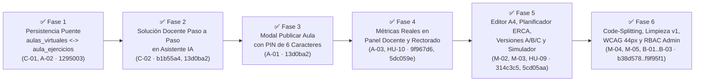

# Hoja de Ruta Incremental — Subsanación y Evolución de ECduLearn

- **Proyecto:** ECduLearn — Plataforma EdTech SaaS B2B (1ro a 3ro BGU · Ecuador)
- **Referencia de Auditoría:** [`docs/AUDITORIA.md`](file:///c:/ECduLearn_Software/docs/AUDITORIA.md) (actualizado al commit `f9f95f1`)
- **Estado Global:** **✅ 6 de 6 Fases Completadas (100 % del Product Backlog — 36/36 puntos implementados y verificados con 0 errores TypeScript).**

---

## Diagrama de Fases Completadas (`b1b55a4` → `f9f95f1`)

---

## ✅ Fase 1: Sincronización de UUID y Tabla Puente `aula_ejercicios` (`1295003`)
* **Hallazgos Resueltos:** `C-01` y `A-02`.
* **Evidencia:** [`ejerciciosController.guardarComoActivo`](file:///c:/ECduLearn_Software/src/services/dbService.ts#L414-L426) y [`aulasController.publicarAula`](file:///c:/ECduLearn_Software/src/services/dbService.ts#L857-L947) aseguran que todo ejercicio publicado exista en `ejercicios_pisa`, tenga su aula activa en `aulas_virtuales` y su fila vinculante en `aula_ejercicios`.

## ✅ Fase 2: Solución Paso a Paso Exclusiva para el Docente (`b1b55a4`, `13d0ba2`)
* **Hallazgo Resuelto:** `C-02`.
* **Evidencia:** [`api/ai.ts`](file:///c:/ECduLearn_Software/api/ai.ts#L56-L70) y [`aiService.ts`](file:///c:/ECduLearn_Software/src/services/aiService.ts#L102-L116) devuelven `solucionDocente`, `respuestaCorrecta` y `pistasSocraticas`, renderizados en [`src/components/ExerciseCard.tsx`](file:///c:/ECduLearn_Software/src/components/ExerciseCard.tsx) con `print:hidden`.

## ✅ Fase 3: Modal de Creación de Aula con PIN de 6 Caracteres (`13d0ba2`)
* **Hallazgo Resuelto:** `A-01`.
* **Evidencia:** [`src/components/PublicarAulaDialog.tsx`](file:///c:/ECduLearn_Software/src/components/PublicarAulaDialog.tsx) y [`generarPinAula`](file:///c:/ECduLearn_Software/src/services/pinService.ts#L4-L10) con `crypto.getRandomValues`.

## ✅ Fase 4: Métricas Reales Docentes y Reporte Institucional (`9f967d6`, `5dc059e`)
* **Hallazgo Resuelto:** `A-03` + **HU-08** y **HU-10**.
* **Evidencia:** [`src/Portal.tsx`](file:///c:/ECduLearn_Software/src/Portal.tsx#L676-L678) consume `metricasController.getMetricasEnVivo()` y [`src/views/ReporteInstitucional.tsx`](file:///c:/ECduLearn_Software/src/views/ReporteInstitucional.tsx) consume `fn_dashboard_institucion()`.

## ✅ Fase 5: Editor A4, Planificador ERCA, Versiones A/B/C y Simulador (`314c3c5`, `5cd05aa`, `4130dd6`)
* **Hallazgos Resueltos:** `M-02`, `M-03` + **HU-06**, **HU-07** y **HU-09**.
* **Evidencia:** [`src/views/EditorGuia.tsx`](file:///c:/ECduLearn_Software/src/views/EditorGuia.tsx), [`src/AdvancedModules.tsx`](file:///c:/ECduLearn_Software/src/AdvancedModules.tsx), [`etiquetaLibre`](file:///c:/ECduLearn_Software/src/services/dbService.ts#L396-L407) y [`src/views/SimuladorAdmision.tsx`](file:///c:/ECduLearn_Software/src/views/SimuladorAdmision.tsx).

## ✅ Fase 6: Modularización, Code-Splitting, Accesibilidad WCAG y RBAC Admin (`b38d578` → `f9f95f1`)
* **Hallazgos Resueltos:** `M-04`, `M-05`, `B-01`, `B-02` y `B-03`.
* **Evidencia:**
  1. Carga diferida (`React.lazy`) y extracción de vistas en [`src/App.tsx`](file:///c:/ECduLearn_Software/src/App.tsx#L1-L175) (`b38d578`, `6a54d10`).
  2. Práctica libre conectada a ejercicios reales, altura táctil `min-h-11` (`44px`) en [`src/AutonomousZone.tsx`](file:///c:/ECduLearn_Software/src/AutonomousZone.tsx#L426) y limpieza de funciones v1 en [`src/services/supabaseClient.ts`](file:///c:/ECduLearn_Software/src/services/supabaseClient.ts) (`5a0c64c`).
  3. Restablecimiento real de contraseña en [`src/views/RestablecerClave.tsx`](file:///c:/ECduLearn_Software/src/views/RestablecerClave.tsx) y restricción RBAC del panel de administración exclusivamente a `role === "admin"` (`b3be951`, `549c275`, `f9f95f1`).

